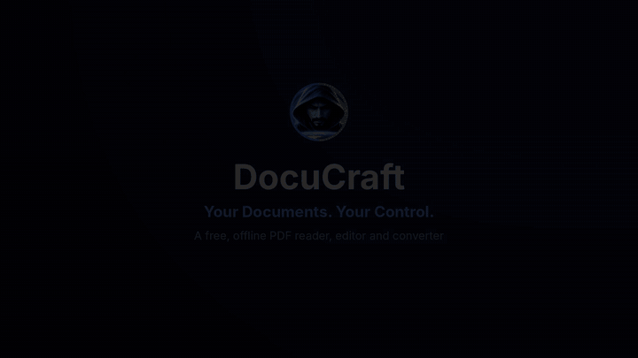
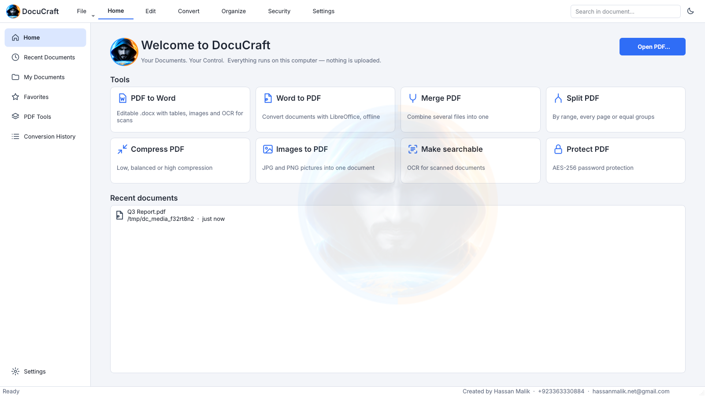
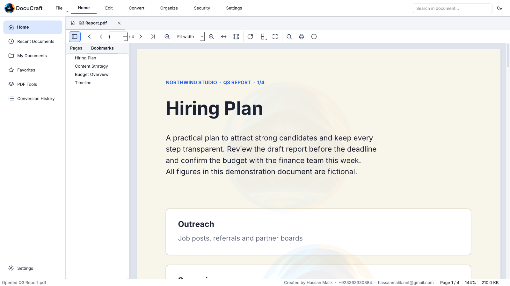
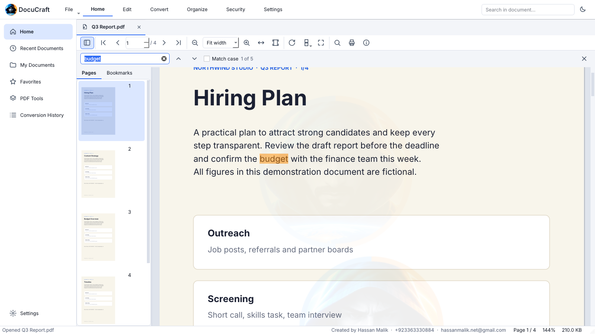
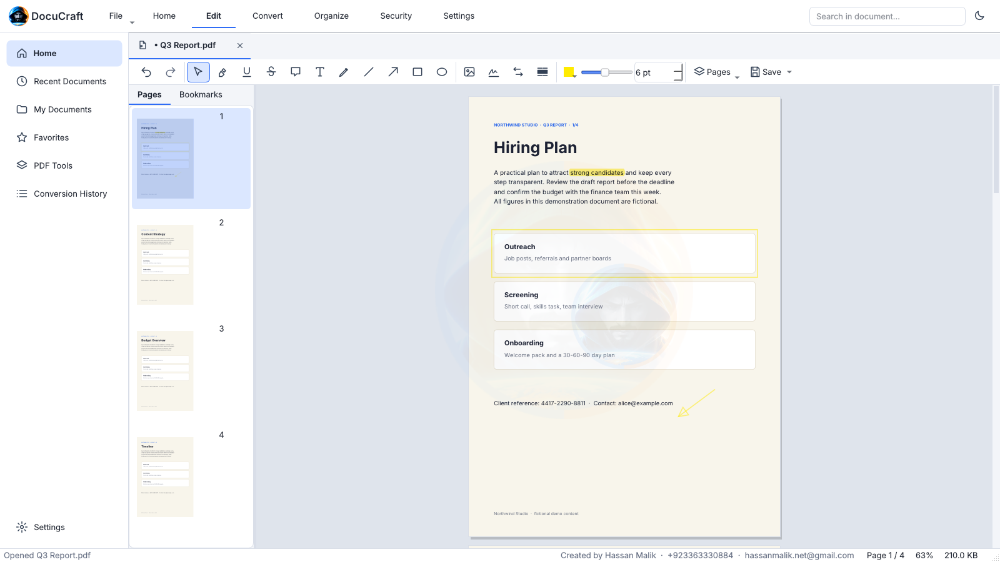
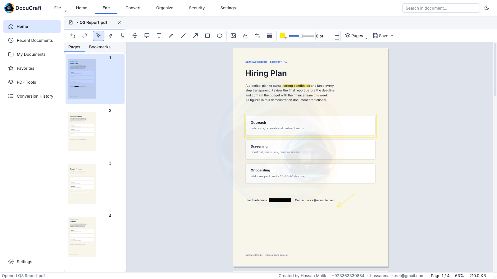
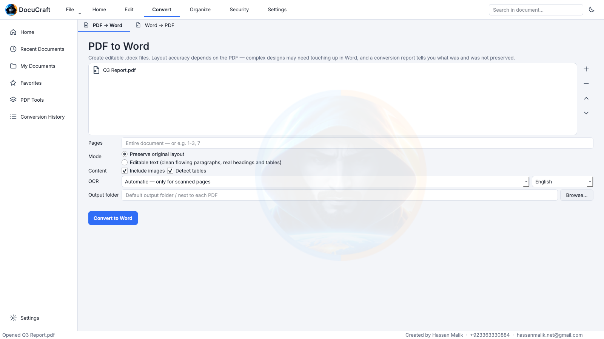
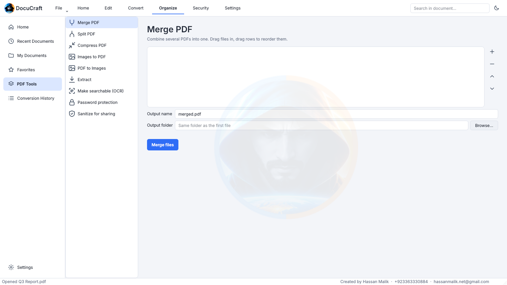
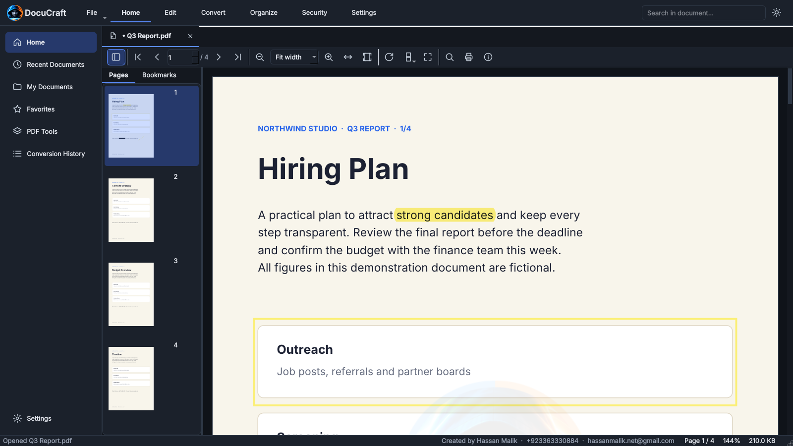
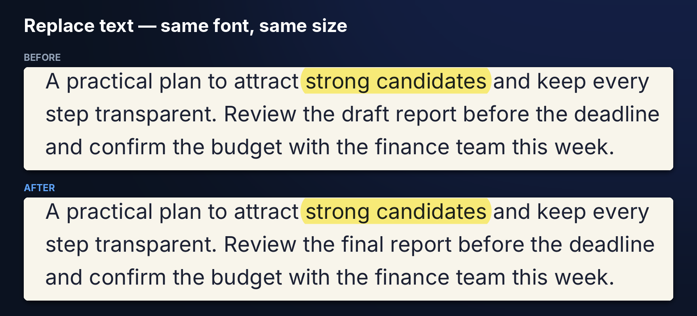

<p align="center"></p>

# DocuCraft — Your Documents. Your Control.

A free, offline desktop app to **read, annotate, edit, secure and convert PDFs** — including PDF → Word. Everything runs on your computer: no accounts, no uploads, no telemetry.



▶ **Full 63-second demo video:** [marketing/media/docucraft-demo.mp4](marketing/media/docucraft-demo.mp4)

> **Status: v0.1.5 preview.** The core is tested (120 automated tests). The Windows build was built and self-tested on a real Windows 10 PC, but **has not yet been tested on a clean machine without Python** — see [Verification status](#verification-status).

## Features
| Area | What you get |
|---|---|
| **Read** | Tabs, thumbnails, bookmarks, search, zoom / fit width / fit page, rotate, single / continuous / two-page layouts, full screen, print and print preview, document info, drag-and-drop, lazy rendering for large files |
| **Annotate & edit** | Highlight, underline, strikethrough, sticky notes, text boxes, freehand, lines, arrows, rectangles, ellipses, images, drawn signatures; colour / size / opacity; undo & redo |
| **Pages** | Insert, delete, duplicate, rotate, reorder (drag), extract, replace pages |
| **Text replacement** | Replace words with a preview. The original words are removed and the new text is placed in the same spot with the same font, size and colour where possible, and the rest of the line moves along. It is not native PDF editing (paragraphs don't re-wrap) and is labelled that way |
| **Redaction** | Real redaction: content is removed from the file and the result is verified — not a black rectangle |
| **Convert** | PDF → Word (layout or editable mode, page ranges, images, tables, OCR for scans, a report of what was and was not preserved); Word → PDF (needs LibreOffice); batch |
| **Organise** | Merge, split, compress, images ↔ PDF, extract text / images / pages, edit metadata |
| **Security** | AES-256 passwords, sanitise (strip metadata / attachments / scripts), safe saving with backups, input validation |
| **Comfort** | Light / dark theme, history, favourites, crash recovery, settings for output folders, quality and more |

**Safe by default:** DocuCraft never overwrites your original without asking, and keeps a backup of the previous version.

## Screenshots
| | |
|---|---|
|  |  |
|  |  |
|  |  |
|  |  |

**Text replacement keeps the look** (same font, size and colour; the rest of the line moves along):



(Screenshots use a fictional demo document and the real UI: `python scripts/make_portfolio_media.py <output_dir>`.)

## Quick usage
1. **Open** a PDF: drag it onto the window, or *File → Open*. Each file gets a tab.
2. **Read:** use the sidebar for thumbnails and bookmarks, `Ctrl+F` to search, and the zoom or fit buttons.
3. **Annotate:** pick a tool (highlight, note, text box, shapes, signature), then drag on the page. `Ctrl+Z` undoes.
4. **Replace text:** choose *Replace text*, select the words, type the new text and check the preview before applying.
5. **Redact:** mark the area or search for a phrase, then apply. The content is removed from the file.
6. **Convert:** open the *Convert* section, pick PDF → Word, choose options and run. Read the report when it finishes.
7. **Save:** *Save As* writes a new file; your original is never overwritten without asking.

More detail: [docs/USER_GUIDE.md](docs/USER_GUIDE.md).

## Install
**Windows 10/11:** download the portable zip from the [Releases](https://github.com/mrchhan/DocuCraft-PDF-Editor/releases) page, unzip it (*Extract All*) and run `DocuCraft.exe`. Windows may show a SmartScreen warning because the app is not code-signed: choose *More info → Run anyway*. **From source (any OS):** see [docs/INSTALLATION.md](docs/INSTALLATION.md).

```bash
python -m venv .venv && . .venv/bin/activate     # Windows: .venv\Scripts\activate
pip install -r requirements.txt
python main.py
```

## Branding and watermark
DocuCraft is a product of **Shadow Creative Studio** (Hassan Malik). The Shadow logo is compiled into the program itself (`core/branding.py`, checked against SHA-256 digests), so replacing an image file on disk does not change what the app shows. It appears in the window icon, header, Home screen and About page, and the footer shows the maker's contact details.

Every file DocuCraft writes carries a small mark: PDFs get a faint emblem in the middle of each page and a footer line ("Made with DocuCraft · Shadow Creative Studio · contact details"), converted Word files get the same footer, and exported page images get the mark burned in. Pages that already carry the footer are never stamped twice. Not marked: plain-text and JSON exports, and images extracted unchanged from a PDF.

The source code is AGPL-3.0-or-later, so anyone can fork and change it, including these marks. The *Shadow* name, logo and artwork are not covered by that licence (see [NOTICE](NOTICE)).

## Honest limitations
- **PDF → Word is never perfect.** Complex layouts, scanned pages and unusual fonts may need touching up in Word. Every conversion shows a report. No accuracy percentage is promised.
- **OCR quality** depends on scan quality and the language data installed.
- **Word → PDF** needs LibreOffice installed separately.
- **Existing text** cannot be edited natively; use the overlay replacement (see above).
- Digital signatures (cryptographic), form-field designer and cloud features are not included in v0.1.
- Tested automatically on Linux and built and self-tested on Windows 10; awaiting a test on a clean machine. The optional Inno Setup installer is scripted but untested.

## Documentation
[Installation](docs/INSTALLATION.md) · [User guide](docs/USER_GUIDE.md) · [FAQ](docs/FAQ.md) · [Development & architecture](docs/DEVELOPMENT.md) · [Licences](docs/THIRD_PARTY_LICENSES.md) · [Security](SECURITY.md) · [Changelog](CHANGELOG.md) · [Contributing](CONTRIBUTING.md)

## Verification status
See [docs/VERIFICATION.md](docs/VERIFICATION.md) for exactly what has and has not been tested.

## Licence
**AGPL-3.0-or-later** (required by the PyMuPDF engine). Copyright © 2026 Hassan Malik (Shadow Creative Studio). See [LICENSE](LICENSE) and [NOTICE](NOTICE).
